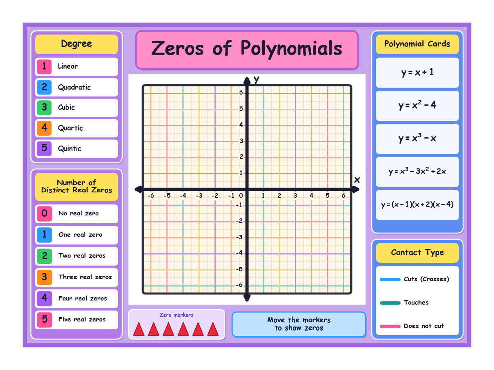

# Maths project – printing files

Print-ready files for the **Zeros of Polynomials** presentation board (Shakthikulangara school
maths project). The board is printed as a sticker; the curves are made on top of it with thread
and 3D-printed joints.

## Download

Open the [`print_files`](print_files) folder, click a file and press **Download** — or use
**Code → Download ZIP** on the repo page to get everything at once.

| File | Type | Use it for |
| --- | --- | --- |
| [`zeros_board_20x15in.pdf`](print_files/zeros_board_20x15in.pdf) | Vector PDF | **Give this to the print shop** |
| [`zeros_board_20x15in.svg`](print_files/zeros_board_20x15in.svg) | Vector SVG | Illustrator, CorelDRAW, Inkscape |
| [`zeros_board_20x15in.eps`](print_files/zeros_board_20x15in.eps) | Vector EPS | Older print / cutting software |
| [`zeros_board_20x15in_300dpi_CMYK.tif`](print_files/zeros_board_20x15in_300dpi_CMYK.tif) | TIFF, CMYK, 300 dpi | Shops that want a CMYK image |
| [`zeros_board_20x15in_300dpi.png`](print_files/zeros_board_20x15in_300dpi.png) | PNG, 300 dpi | Lossless image |
| [`zeros_board_20x15in_300dpi.jpg`](print_files/zeros_board_20x15in_300dpi.jpg) | JPG, 300 dpi | Smaller image, for WhatsApp / email |

All images are 6000 × 4500 px (20 × 15 in at 300 dpi).

## Tell the print shop

- **Size: 20 × 15 inches**, trim at the page edge.
- **Print at 100 % / actual size – no scaling, no "fit to page".** The grid measurements matter.
- The outer 1 inch is plain white, so no bleed is needed.
- Fonts are embedded (PDF) or converted to outlines (SVG).
- Ask for a proof if colours matter – screen colours may print slightly duller.

## Measurements

| Part | Size |
| --- | --- |
| Whole sticker | 20 × 15 in |
| White border (all sides) | 1 in |
| Purple board | 18 × 13 in |
| Grid square | 0.65 in |
| Axes | −6 to 6 on both x and y |

## Also here

- `graph_sheet_20x12.pdf` – plain funky graph sheet, 20 × 12 in with 1.5 in border.
- `make_zeros_board.py`, `make_graph_sheet.py` – scripts that regenerate the files
  (`python3 make_zeros_board.py`; needs matplotlib and Pillow, uses macOS Comic Sans).
